# ENTITY RELATIONSHIP DIAGRAM (ERD)
## Sentanu ERP — V1

Diagram dipecah per domain agar terbaca. Notasi: `||--o{` = one-to-many, `||--||` = one-to-one.

---

## 0. PETA DOMAIN

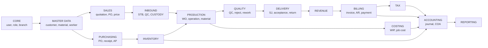

---

## 1. CORE & SECURITY

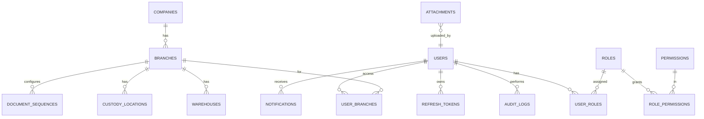

**Catatan:** `ATTACHMENTS` bersifat polymorphic (`entity_type` + `entity_id`) agar dapat dipakai oleh semua dokumen.

---

## 2. MASTER DATA

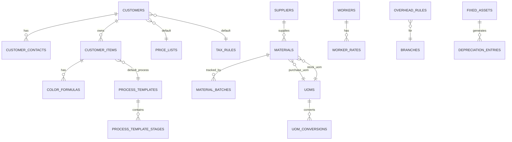

---

## 3. SALES & PRICING

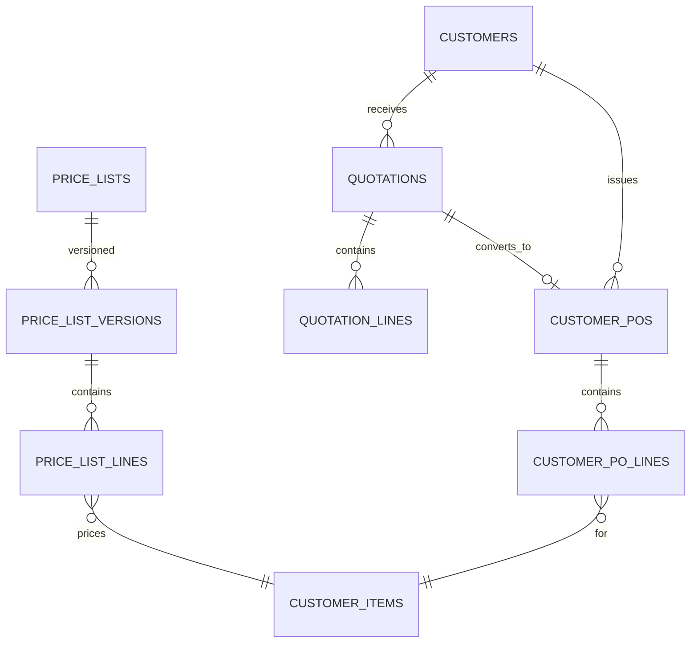

**Aturan kunci:** `CUSTOMER_PO_LINES.unit_price` adalah **snapshot**, tidak pernah ikut berubah jika price list diperbarui.

---

## 4. INBOUND & CUSTODY (inti pembeda sistem ini)

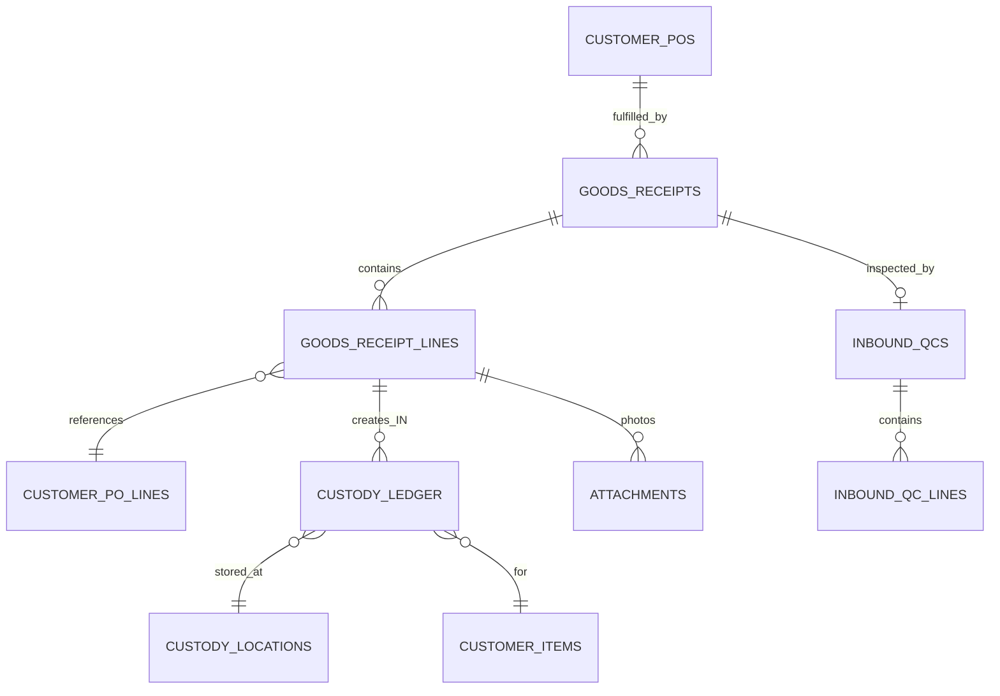

**Aturan kunci:**
- `GOODS_RECEIPTS` (STB) **tidak** terhubung ke `STOCKS` maupun `JOURNALS`.
- `CUSTODY_LEDGER` hanya punya kolom kuantitas, **tidak ada kolom nilai/harga**.

---

## 5. PRODUCTION

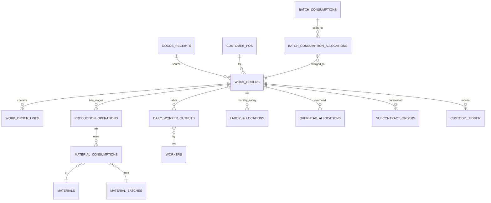

---

## 6. QUALITY

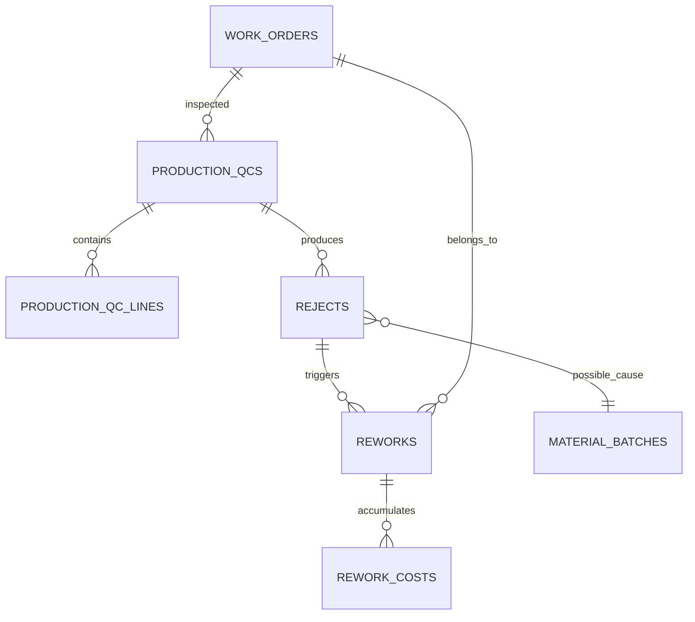

**Aturan kunci:** `REJECTS.cost_responsibility` (INTERNAL / CUSTOMER / SUPPLIER) menentukan apakah biaya rework jadi beban atau dapat ditagih.

---

## 7. DELIVERY, ACCEPTANCE & REVENUE

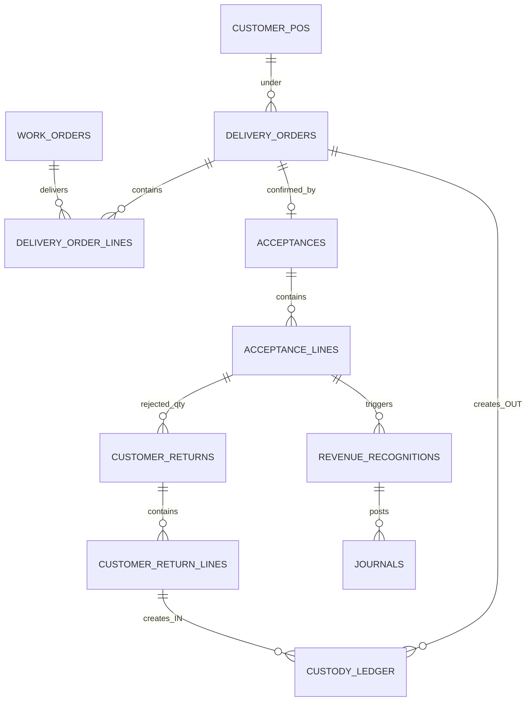

**Aturan kunci:**
- `DELIVERY_ORDERS.invoice_status` = UNINVOICED / PARTIALLY_INVOICED / INVOICED.
- `REVENUE_RECOGNITIONS` hanya lahir dari `ACCEPTANCE_LINES.quantity_ok`.

---

## 8. BILLING, AR & TAX

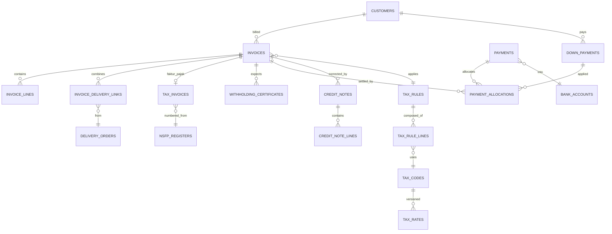

**Aturan kunci:** relasi `INVOICE_DELIVERY_LINKS` adalah tabel jembatan yang mewujudkan aturan **N Surat Jalan → 1 Invoice**.

---

## 9. PURCHASING, AP & INVENTORY

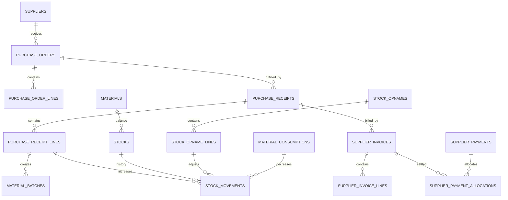

---

## 10. ACCOUNTING & COSTING

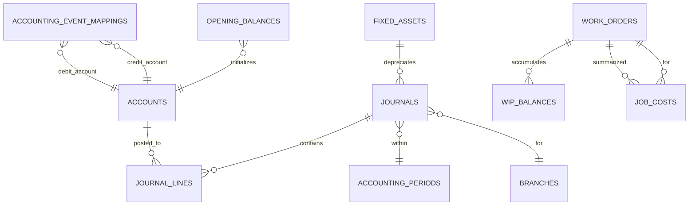

**Aturan kunci:** `ACCOUNTING_EVENT_MAPPINGS` adalah tabel yang membuat matriks jurnal (Appendix A Master Prompt) menjadi **data, bukan kode**. Mengubah pemetaan akun tidak memerlukan deployment.

---

## 11. RELASI LINTAS DOMAIN YANG PALING KRITIS

| Relasi | Kardinalitas | Aturan |
|---|---|---|
| Customer PO → Surat Jalan | 1 : N | 1 SJ hanya boleh 1 PO |
| Surat Jalan → Invoice | N : 1 | Banyak SJ boleh 1 invoice, syarat customer sama |
| Acceptance → Revenue | 1 : 1 per line | Revenue hanya dari quantity_ok |
| WO → Custody Ledger | 1 : N | Setiap perpindahan stage tercatat |
| STB → Stock | **TIDAK ADA** | Dilarang keras |
| STB → Journal | **TIDAK ADA** | Dilarang keras |
| Material Consumption → Journal | 1 : 1 | Dr WIP / Cr Inventory |
| Acceptance → Journal | 1 : 2 | Revenue + WIP→COGS |
| Invoice → Journal | 1 : 1 | AR + PPh + Unbilled + PPN |

---

## 12. ATURAN PENAMAAN & KONVENSI

```text
Tabel          : snake_case, jamak (customers, invoices)
Primary key    : id (UUID v7 atau BIGINT identity)
Foreign key    : <singular>_id (customer_id)
Boolean        : is_* / has_* (is_active)
Timestamp      : created_at, updated_at, deleted_at, posted_at
Audit kolom    : created_by, updated_by, posted_by
Nomor dokumen  : <entity>_number, unique per company
Status         : kolom `status`, tipe enum/varchar dengan CHECK constraint
Uang           : NUMERIC(18,2) — JANGAN pakai FLOAT
Kuantitas      : NUMERIC(18,3)
Rate pajak     : NUMERIC(7,4)
```
